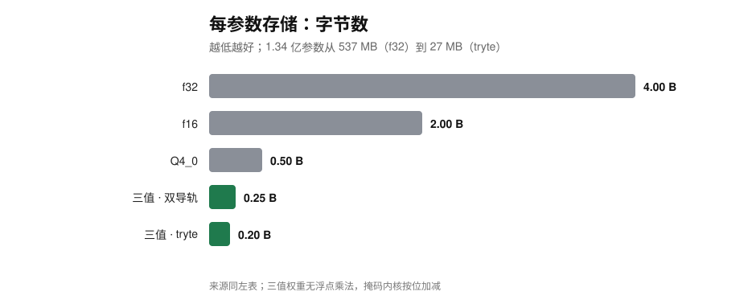
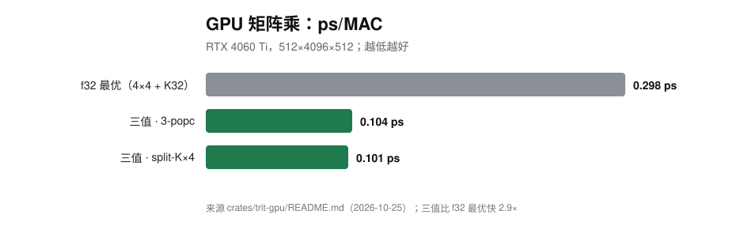

# trit —— Rust 三进制工具箱（balanced ternary / 三值逻辑 / 三值内核）

[](https://github.com/bfxh/trit/actions/workflows/ci.yml)
[](https://crates.io/crates/sansheng)
[](https://docs.rs/sansheng)

**是什么**：在二进制机器上，把三进制真正能落地的那一层做成可复用 Rust crate——
三值逻辑（Kleene K3 / Łukasiewicz Ł3 / Bochvar B3）、真值表与穷举等价、双导轨打包、
CPU 掩码与 tryte 查表内核、GPU 三值内核、位平面 ALU、三值训练（STE/QAT）、
TT3/TTX 资产容器、`.tri` 语言服务器、WASM Playground 与 `trit` CLI。

**搜索关键词**：Rust ternary · balanced ternary · trit · three-valued logic · Kleene K3 ·
Łukasiewicz · Bochvar · BitNet · ternary weights · ternary GPU kernel · 5 trits per byte ·
GF(3) · ternary codec · ternary inference · QAT · STE · 三进制 · 三值逻辑。

> 一句话：不是"把 float 换成三值"，而是把 `{-1,0,+1}` 能**省带宽**、能**去掉乘法**、
> 能**表达"未知"**这三件事，分别做成有实测、可复算的 crate。

## 一眼看强弱（同机实测，复算入口在每张图下面）






- **CPU 流式**：tryte 查表 **124.4 GMAC/s = 15.2× f32、2.0× Q4_0**，每参数只要 0.2 B。
- **自动选核** **129.8 GMAC/s（15.8× f32）**，有效带宽 32.5 GB/s，已贴近本机 33 GB/s 的访存墙。
- **GPU**：三值 3-popc **0.104 ps/MAC，2.9× f32 最优内核**（RTX 4060 Ti，512×4096×512）。
- **精度**：三值权重是精确的 `±1/0`，流式 `max_err` 3e-5；Q4_0 是 1.2e-1。
- **不是只省字节**：掩码内核把 `x·{-1,0,+1}` 变成按位加减，全程无浮点乘法。

### 和谁比、不跟谁比

| 对标 | 同机实测 | 结论 |
|---|---|---|
| f32 / f16 / Q4_0 | 是 | 上面三张图；Q4_0 是 0.5 B/参数，tryte 是 0.2 B |
| llama.cpp | 否 | 不做同机对比，也不引用外部读数 |
| BitNet b1.58 | 否 | 都是 ~1.6 bit/参数；没有同机模型读数，不宣称快慢 |

## 三进制的代价（先看再决定用不用）

- **浮点精度更差**：同比特存储，三值浮点误差上界是二进制的 **3 倍**（白丢约 1.58 bit）。
- **GPU subgroup 路径更慢**：1.341 vs SIMT 0.298 ps/MAC（**4.5×**）。
- **2-popcount 是负结果**：比 3-popcount 慢 1.9%。
- **tryte 只在大行数赢**：49152 行仍比掩码慢 5.5%，反超点在 65536 行。
- **CPU 三值内核没打满带宽墙**：掩码 21.5、tryte 24.9 GB/s vs 33 GB/s（65–75%）。
- **STE 变体在小任务上同分**：选型需要更大/带噪任务。
- **打包算术不划算**：三进制进位串行，本仓只做逻辑 + 位并行点积。

完整清单与复算命令：[docs/LESSONS.md](docs/LESSONS.md)（经验与负结果）。

定位与边界：[docs/DESIGN.md](docs/DESIGN.md)。

## 预编译产物

GitHub Releases（`v0.3.1` 起）提供：

| 平台 | 产物 |
|---|---|
| Linux x86_64 | `trit-linux-x86_64.tar.gz` |
| Windows x86_64 | `trit-windows-x86_64.zip` |
| macOS arm64 | `trit-macos-aarch64.tar.gz` |
| 校验 | `SHA256SUMS` |

## 工作区

| crate | 内容 |
|---|---|
| `trit-core` | `Ternary`、`TriState`（0/1/Z）、三值拓扑、K3/Ł3/B3、AST、解析器、位并行 `TriBit`、位切片 `TriVec` |
| `trit-eval` | 求值、真值表、穷举等价、化简 |
| `trit-sat` | dual-rail + SAT 等价判定与反例 |
| `trit-circuit` | 组合网表 X 传播、stuck-at/桥接可测性、ATPG、STA-lite、技术映射、结构化 Verilog |
| `trit-belnap` | Belnap 四值（T/F/B/N）的 opt-in 语义 |
| `trit-wasm` | WASM 绑定：给 `playground/` 的求值、真值表、等价 |
| `trit-bdd` | BDD（canonical）等价判定、三值量化 |
| `trit-policy` | 三值决策表的构建期验证 |
| `trit-schedule` | 三值依赖的静态 DAG 调度（True/False/Unknown） |
| `sansheng` | 三生：统一入口伞包（re-export 以上能力） |
| `trit-cli` | `trit` 命令行 |

**实验层**（`publish = false`，不属于稳定 API；彼此**不许互相依赖**，否则 `cargo package` 会断）：

| crate | 内容 | 入口 |
|---|---|---|
| `trit-net` | 三值权重前向 + `X` 输入「确定/弃权」+ `TRN1` 模型格式 + STE 反向传播 | `trit-net infer/train/format` |
| `trit-machines` | 三值栈式解释器 / 一维元胞自动机 / `{-1,0,+1}` 突触脉冲神经元 | `trit-machines vm\|ca\|snn` |
| `trit-codec` | 5 trits/byte、平衡三进制、GF(3) `[4,2,3]` 纠错、按分布选编码、零拷贝视图 | `trit-codec pack\|plan\|...` |
| `trit-float` | 平衡三进制浮点：舍入模式、同比特范围/精度交换、Takum 式锥形精度原型（同比特精度仍是二进制的 3 倍误差） | `trit-float stats\|range\|rounding` |
| `trit-attn` | 注意力 = 快权重 FFN 的双视角、三值整数关联记忆 | `trit-attn demo` |
| `trit-dot` | 位并行三值/二值点积（XNOR+POPC 的适用边界）、块级稀疏、硬件 `popcnt` 运行时派发 | `trit-dot bench` |
| `trit-gpu` | WGSL `countOneBits` 内核（`--features gpu` 构建） | `trit-gpu bench --trits N` |
| `trit-ops` | 三值推理算子（双导轨掩码 / tryte 查表 / 自动选核）：流式 15.8× f32、0.2 B/参数 | `bench`（`crates/trit-ops`） |
| `trit-texture` | TT3/TTX 三值纹理容器：2.40 bpp、GF(3) CRC-16、CPU/GPU 解码 | `trit-texture` |
| `trit-unsafe` | 用 K3 审 unsafe：每个点判 Safe / Unknown / Risky 并按 crate 合成 | `trit-unsafe` |
| `trit-procscan` | 进程行为扫描 + 自动分析 + MCP 配置优化（非管理员可用的证据面） | `trit-procscan` |
| `trit-lsp` | `.tri` 语言服务器：诊断 / 悬停真值表 / 补全 / 文档符号 | `trit-lsp` |
| `trit-train` | 三值训练 M0：STE 三变体 + 每行 scale + 位平面 ALU | `train-bench` |
| `trit-graph` | 三态结构基础：三态节点/边的位集图、拓扑序、DFS 树、三态议会 | 库（无二进制） |

## 三态与三值拓扑

`TriState` 表示 0 / 1 / Z（高阻），与逻辑未知 `X` 区分：`Z` 不驱动总线，可被其他驱动覆盖。
`TriState::resolve` 逐条解析驱动，0 与 1 同时驱动报冲突；`TriStateBus` 做逐位解析，
`to_ternary()` 把 `Z` 映射为 `Unknown`。

`TernaryTopology` 是有向图的三值可达性：边值 `True` / `Unknown` / `False`；路径值取边值最小值，
同一对节点取所有路径最大值。纯 `True` 路径 → `True`，只有含 `Unknown` 边的路径 → `Unknown`，
没有可用路径 → `False`；`False` 边视为断开。

```rust
let mut graph = TernaryTopology::new(3);
graph.add_edge(0, 1, Ternary::Unknown)?;
graph.add_edge(1, 2, Ternary::True)?;
assert_eq!(graph.reachability(0)?, vec![
    Ternary::True, Ternary::Unknown, Ternary::Unknown,
]);
```

## 三值调度（`trit schedule`）

静态 DAG 调度：依赖边可以是 `True`（必需）、`False`（可选，忽略）或 `Unknown`（未知）。
`Unknown` 不会被猜成可运行，而是把任务及依赖它的任务标记为 `deferred`，给出原因。

```json
{
  "workers": 2,
  "tasks": [
    {"id": "a", "duration": 3},
    {"id": "b", "duration": 2, "deps": [{"task": "a"}]},
    {"id": "c", "duration": 1, "deps": [{"task": "a", "required": "Unknown"}]}
  ]
}
```

```bash
trit schedule tasks.json --workers 2 --format json
```

输出 `scheduled`（开始/完成/worker/优先级）、`makespan`、`critical_path` 和 `deferred`
（`unknown_dependency` / `blocked_by`）。这是**静态调度**：不负责实际执行、抢占、取消或故障恢复。

### Runtime（库）

`trit_schedule::run_runtime(tasks, workers, CancelToken)` 按依赖完成动态取任务：

```rust
use trit_schedule::{CancelToken, RuntimeTask, run_runtime};
let tasks = vec![RuntimeTask::new("a", vec![], |token| {
    if token.is_cancelled() { return Err("cancelled".into()); }
    // ... 实际工作 ...
    Ok(())
})];
let report = run_runtime(tasks, 2, CancelToken::new()).unwrap();
```

取消是**协作式**的：未开始的任务不再启动；已经在跑的任务不会被强杀，必须自己检查 token。
失败或取消后停止派发新任务，报告 `completed` / `failed` / `cancelled` / `deferred`。

资源配额用 `RuntimeConfig::with_capacity(Resources::new(cpu, memory))`，任务用
`RuntimeTask::with_requirements(...)` 声明需求；队首任务放不下时等待，不跳过它去塞低优先任务。
运行中的任务**不会**被抢占；优先级只影响准入顺序。

### 可恢复任务协议（resumable）

需要真正抢占时，任务要实现 `ResumableTask::step`：每次只推进一个有界步骤，返回
`Progress::Yield` 表示可在步骤边界暂停；对象本身保存检查点状态。

```rust
use trit_schedule::{Progress, ResumableSpec, RuntimeConfig, StepContext, run_resumable,
                     CancelToken, ResumableTask};

struct Job { done: usize }
impl ResumableTask for Job {
    fn step(&mut self, _ctx: &StepContext) -> Progress {
        self.done += 1;
        if self.done == 10 { Progress::Done } else { Progress::Yield }
    }
}
let report = run_resumable(
    vec![ResumableSpec::new("job", vec![], Job { done: 0 })],
    RuntimeConfig::new(1),
    CancelToken::new(),
).unwrap();
```

`run_resumable` 是**单线程步进式参考执行器**；`run_resumable_threaded` 是多线程版本：
worker 在 `Yield` 边界检查更高优先级任务，必要时把当前任务放回 ready 并释放资源，
任务对象保留、之后从原状态继续。两者都不强杀正在执行的 `step`。

两个 runtime 报告都包含 `RuntimeMetrics`：`started/completed/failed/cancelled/deferred/
preemptions/steps/peak_usage`。`started` 按任务去重，抢占后恢复不会重复计数。
### 检查点协议（checkpoint）

任务实现 `CheckpointTask::save_state` 编码自身状态；恢复方实现 `TaskRestorer::restore`
按任务 id 重建任务。`Checkpoint` 带格式版本，`CheckpointStore` 按 id 覆盖保存。
`CheckpointedTask` 把检查点任务包成普通 `ResumableTask`，在每次 `Yield`/`Done` 后写入
共享存储，单线程/多线程执行器都能直接用。

```rust
let store = Arc::new(Mutex::new(CheckpointStore::new()));
let task = CheckpointedTask::new("counter", Counter::new(10), Arc::clone(&store));
let report = run_resumable(
    vec![ResumableSpec::new("counter", vec![], task)],
    RuntimeConfig::new(1),
    CancelToken::new(),
).unwrap();
// 进程重启后：
let restored = store.lock().unwrap().restore(&MyRestorer, "counter")?;
```

状态编码格式由任务决定（JSON / bincode / 自定义字节），协议只规定边界与版本。

落盘用 `FileCheckpointStore`：布局 `<root>/v1/<hex(task_id)>/<generation>.json`。
每次保存写同目录临时文件，再 `rename` 到**新**代文件，不覆盖旧代；加载取最大代。
`prune(task_id, keep)` 控制保留代数，`remove(task_id)` 清理任务目录。

`index()` 扫描版本目录生成按 task id 排序的 `CheckpointIndex`（task id、最新代、状态字节数），
只读元数据不加载状态；`task_ids()` / `index_json()` 便于外部工具消费。

多进程写同一根目录时用 `try_lock()` / `lock_timeout()` / `lock()` 获取跨进程锁；
锁是 `v1/.lock` 目录的原子创建，`CheckpointLock` 丢弃时自动释放。锁不自动加在
`save`/`load` 上，调用方需在临界区显式持有。

重启用 `restore_specs`：按静态描述 `ResumableSpecDef` 从 `CheckpointSource`（内存或文件）
读取检查点，存在则 `TaskRestorer` 恢复，不存在则 `TaskFactory` 建新任务，再交给 runtime。

```rust
let specs = restore_specs(defs, &file_store, &MyRestorer, &MyFactory)?;
let report = run_resumable_threaded(specs, config, CancelToken::new())?;
```

指标可直接导出 Prometheus/OpenMetrics 文本：

```rust
let text = report.metrics.to_prometheus();          // 前缀 trit_schedule
let text = report.metrics.to_prometheus_with("ci"); // 自定义前缀
let text = report.metrics_prometheus();             // 报告便捷方法
```

## 三生（sansheng）

crates.io 包名用拼音 `sansheng`（`三生` 不能直接作 crate 名）。伞包统一暴露核心 API：

```toml
[dependencies]
sansheng = "0.12"
```

```rust
use sansheng::{equivalent_symbolic, Algebra, Parser};
```

CLI 仍是 `trit`（`cargo install trit-cli` 或下载 Release 二进制）。

API 文档：<https://docs.rs/sansheng>。

## 快速开始

```bash
cargo run --release -p trit-cli -- eval "a & b" -s "a=1,b=X"
cargo run --release -p trit-cli -- equiv "a & (b | c)" "(a & b) | (a & c)"
cargo run --release -p trit-cli -- -a lukasiewicz equiv "X => X" "1"
cargo run --release -p trit-cli -- equiv --symbolic "..." "..."   # 大变量数走 SAT
cargo run --release -p trit-cli -- equiv --symbolic --binary-all --stats "..." "..."
cargo run --release -p trit-cli -- equiv --symbolic --minimize "a & (b | !b)" "0"
cargo run --release -p trit-cli -- equiv --bdd "a & (b | c)" "(a & b) | (a & c)"
cargo run --release -p trit-cli -- quantify "a | !a" --vars a --kind forall
cargo run --release -p trit-cli -- verify examples/policy.json
```

`--algebra` / `-a` 选 `kleene`（默认）、`lukasiewicz`、`bochvar`；不等价退出码为 `2`。
穷举默认在 >18 变量时报错并提示 `--symbolic`（`--max-vars N` 可调）。

## 二进制 ↔ 三值：零开销

双导轨 `(ones, unknowns)` 是**进程内表示**：`(0,0)=False`、`(1,0)=True`、`(0,1)=Unknown`，禁止 `(1,1)`。
它**不是**跨语言/持久化的字节协议：没有头部、版本、字节序或 padding 约定；CLI 的 JSON 也没有 `schema_version`。
需要跨进程交换时请显式定义自己的格式，不要把 `Vec<u64>` 的内存布局或 Serde 枚举标签当协议。
二进制数据就是 `unknowns` 缺失：

- `Ternary::from_bool` / `to_bool`：标量边界；
- `TriBit::from_binary(u64)` / `as_binary()`：64 路位并行的零开销桥；
- `TriVec::from_binary(Vec<u64>, len)`：**接管**位平面（多余字截断、尾部掩码），不复制、不分配 unknown 平面；
  只有写入 `Unknown` 时才惰性分配第二平面。

实测（1,048,576 元素，release，同机单次；`cargo run --release -p trit-core --example bulk_bench`）：

| 操作 | 耗时 | 吞吐 |
|---|---|---|
| `bool[] -> TriVec` 打包 | 0.65 ms | 1.62 G elem/s |
| K3 `AND`（位并行） | 0.033 ms | 31.9 G elem/s |
| `TriVec -> bool[]`（纯二值） | 0.97 ms | 1.08 G elem/s |
| `from_binary` 二进制视图 | 0.002 ms | 仅 move，无复制 |

## 资源预算与质量数据

所有子命令支持全局 `--timeout-ms N`：把本次调用重新执行为子进程，超时后杀掉并退出 **124**。
这是**进程级硬超时**（能兜住整个 ATPG/验证/REPL），不是单故障取消；子进程用
`TRIT_TIMEOUT_CHILD=1` 跳过二次包装。

所有入口共用 `trit_core::Limits`（默认：深度 256 / 节点 100 000 / 枚举 12 变量 / 100 万行）：

- 解析器在**构造 AST 的过程中**扣节点预算：右结合蕴含链、扁平二元链、`!` 链与深括号
  都受深度上限约束；输入文本超过 1 MiB 在转 `Vec<char>` 之前拒绝。
- `check_expr` 迭代遍历 AST；`Evaluator::assignment_count` / `chunk_planes` /
  `evaluate_within` 用 checked 计数与行数上限，不用饱和值冒充精确赋值数。
- `truth_table_within` / `eval_within` / `equivalent_within`：`trit-eval` 的带预算版本；
  Belnap `table_within` / `equivalent_within` 与电路 `combination_count` 使用同一套错误类型。
- SAT / BDD / 策略入口先 `check_expr`（在收集变量之前）再编码，超限返回结构化
  `Limit`／`BudgetExceeded` 错误；策略展开在分配大子树之前扣节点预算。
- CLI 在默认值上收紧：`table` / REPL 与 WASM 只允许 10 个变量，网表分析最多 10 个主输入。

**可复算的质量数据**：`scripts/mutation_check.py` 对 **291** 条关键规则做单点文本变异并跑回归；
fuzz 目标 8 个（netlist / verilog / atpg / blif / aiger / expr / policy / netlist_json）；
测试矩阵覆盖 Linux / Windows / macOS 三平台 + MSRV 1.88 + wasm32。贡献流程见
[CONTRIBUTING.md](CONTRIBUTING.md)。

**对比与测量的规则**见 [`docs/TERNARY-BOUNDARIES.md`](docs/TERNARY-BOUNDARIES.md) §6/§7：
任何对比必须同时给二进制基线（同机 f32/f64 或 1-bit 二值），并写明省的是带宽还是指令数；
负结果统一记在 [`docs/LESSONS.md`](docs/LESSONS.md)。

## fuzz 与基准

- 结构生成属性测试（CI 每次跑）：`cargo test -p trit-core --test structure`
  —— 任意 AST 经 `to_infix` 往返后结构/深度不变；扁平链与右结合蕴含链在深度预算边界精确接受/拒绝；
  任意文本只返回 `Ok/Err`。策略侧另有 `expand_budget_is_exact_*` / `expand_depth_is_enforced`。
- 稳定版 smoke（CI 每次跑）：
  - `cargo test -p trit-circuit --test fuzz_smoke` —— 网表/Verilog/BLIF/AIGER/JSON 变异输入的解析往返、
    坏电路导出不 panic、随机电路 ATPG 覆盖不变量；
  - `cargo test -p trit-policy --test fuzz_smoke` —— 随机 JSON 与结构生成策略只返回 Ok/分类错误。
- 覆盖率引导 fuzz（`fuzz/`，cargo-fuzz，需要 nightly）：`parse_netlist` / `parse_verilog` /
  `atpg` / `blif` / `aiger` / `expr` / `policy` / `netlist_json`。
  Windows 上需要 clang-cl + MSVC 才能链接 libFuzzer；CI 不构建这一层。
- 覆盖率引导 fuzz（需要 nightly + cargo-fuzz）：

```bash
cargo install cargo-fuzz
cargo +nightly fuzz run parse_netlist
cargo +nightly fuzz run parse_verilog
cargo +nightly fuzz run atpg
cargo +nightly fuzz run blif
cargo +nightly fuzz run aiger
```

- 基准：`bash scripts/bench.sh`（release；本机 Windows 一次读数，仅供参考）：

| 项目 | 迭代 | per iter |
|---|---|---|
| netlist parse（32 门链） | 2000 | 7.3 µs |
| verilog parse（32 级 assign） | 2000 | 20.8 µs |
| timing analyze | 2000 | 43.7 µs |
| map nand-only | 500 | 73.1 µs |
| map timing-driven | 500 | 65.7 µs |
| atpg（6 输入链） | 50 | 81.1 µs |

## 符号化等价（SAT）

每个 trit 用两根布尔导轨，按所选代数的真值表逐门加子句，K3/Ł3/B3 共用编码。
等价判定 = 断言两个根不相等，UNSAT 即等价；SAT 时从模型还原反例。

同机单次（n 个变量的 AND 链与自身比较）：

| 变量数 | 穷举 | `--symbolic` |
|---|---|---|
| 12 | 0.05 s | 0.016 s |
| 18 | 12.6 s | 0.016 s |
| 20 | 护栏报错 | 0.017 s |
| 50 | 不可行 | 0.020 s |
| 100 | 不可行 | 0.025 s |

纯二值公式可声明 `--binary-all`（或 `--binary a,b`）：二值子图走经典 CNF，不再付 18 条三值子句。
100 变量 AND 链实测：**3866 → 598 条子句，0.028 s → 0.0147 s**；`--stats` 打印编码规模。

反例编号与 `decode_assignment` 的约定一致。

**反例最小化**（`--minimize`）：从完整模型出发，逐个试删变量；用“断言两边相等”的对偶编码检查，
删掉后若仍可相等就必须保留。得到的是**充分**部分反例——未列出的变量在各自域内任取，两边仍不相等；
不会退化成“只保证存在某个补全”的空反例。

## 技术映射（`trit map`）

默认把 AND/OR/NAND/NOR/NOT/BUF/经典 XOR 降到 NAND + 常量。三值强加 `Xor` 需要 X 检测单元，明确拒绝。

```bash
trit map design.net --to verilog
```

给单元库时按时序选实现：每个门在「直接单元」与「NAND 展开」之间取到达时间更短者
（拓扑序上的最长路径 DP，关键路径最优）；`--area-first` 改成面积优先（单元 `area`，
未声明按 1，因此旧库等价于单元数最少）。

```bash
trit map design.net --cells cells.json --to verilog
trit map design.v --from verilog --cells cells.json --area-first
trit map design.net --cells cells.json --load-delay 2   # 扇出按负载延迟参与选实现
```

`cells.json` 是「门类型 → 延迟 / 面积」的对象；没列出的类型视为库里没有该单元
（与 `timing --library` 的 `default_delay` 语义不同）。值可以是数字，也可以是
`{delay, area}` 或按输入引脚（Liberty 的 `A1`/`A2` → `Y`）给弧延迟的
`{delay, arcs, area}`；`area` 省略按 1：

```json
{ "NAND": 1, "AND": {"delay": 3, "arcs": [1, 4], "area": 2}, "OR": {"delay": 5, "area": 1}, "XOR2": 4 }
```

`arcs` 的长度必须等于门元数；`delay` 省略时取弧最大值，只用于不区分引脚的粗估。
直接单元与 NAND 展开都按各自输入引脚的弧算到达时间，所以慢弧会改变实现的取舍。

## 设计检查（`trit check`）

一条命令跑：结构校验 → 时序（关键路径/违例）→ X 传播统计 → ATPG 覆盖率；
`--min-coverage` 与 `--clock` 是失败条件，任一不满足退出码 1。

```bash
trit check design.v --from verilog --clock 10 --min-coverage 0.9
trit check design.net --clock 4 --library cells.json --format json
```

## 时序估算（`trit timing`）

组合、单位延迟的 STA-lite：默认输入到达 0，每个非常量门加 `--delay`（默认 1），
`--clock N` 给出周期时按反向传播算 required/slack，负 slack 记为违例。

`--constraints io.json` 给 I/O 时序约束；未列出的输入按 0，未列出的输出按 `--clock`
（省略 clock 时按关键路径）。`--paths` 也从输入到达时间开始计：

```json
{ "input_arrival": { "a": 2 }, "output_required": { "y": 10 } }
```

```bash
trit timing design.net --clock 10 --constraints io.json
trit timing design.v --from verilog --delay 2 --format json
trit check design.net --constraints io.json --min-coverage 0.9
```

`--library cells.json` 可按门类型给延迟（`{"default_delay":1,"delays":{"AND":2}}`），优先于 `--delay`；
库里也可写 `"load_delay": N`，或直接用 CLI `--load-delay N`：每个扇出（门输入引用）追加 N 周期。
按输入引脚给弧延迟用 `arcs`（键同样是门类型短名，长度等于门元数）：

```json
{ "default_delay": 1, "load_delay": 0, "arcs": { "AND": [1, 4], "NOT": [2] } }
```

有 `arcs` 的门类型按「输入到达 + 该引脚弧延迟」取最大值，再追加负载延迟；没有的仍走
`delays` / `default_delay`。`trit check --library` 使用同一份模型。
`--paths N` 列出最慢的 N 条路径（信号序列 + 延迟）；JSON 里是 `paths`。

`--sdf file.sdf` 直接读 SDF 的 IOPATH 延迟（与 `--library` 互斥）：

- 只取 `(CELL (CELLTYPE ...) (DELAY (ABSOLUTE (IOPATH ...))))`；rise/fall、`min:typ:max`
  都取**最坏值**，`COND` 条件弧并入同一 celltype，最后**向上取整**为整数周期。
- **per-instance**：`(INSTANCE u1)` 对齐层级展开后的门实例（`Gate::instance`，如 `u1` / `u1.u2`），
  该实例的所有 IOPATH 取最坏值，优先于 celltype；SDF 带顶层前缀（`top.u1`）也接受。
  匹配不到时才回退到按 celltype（`AND2` / `NAND3` / `INV` / `BUF` ...）的最坏值；
  `XOR`/`XOR2`/`XOR3` 一律映射经典异或（Verilog `xor` ⇒ `XorClassic`）；三值强加门
  没有对应的 SDF 单元名，不会靠 celltype 静默套用。
- 仍未保留**引脚级**差异（实例内 rise/fall/条件弧合并成一个最坏值）；`TIMESCALE` 不换算，
  SDF 未覆盖的门类型回退到 `--delay`。
- 未知 celltype（如触发器）忽略；一个可识别延迟都没有时明确报错。
- 这是 **SDF-lite**：用于把综合/布局后的延迟粗注进 STA-lite，不是签核级 SDF 语义。

## BDD 引擎（`--bdd`）

第三条等价路径：把双导轨直接建成 BDD，差集 BDD 为 false 即等价。BDD 是 canonical 的，
二值变量只建一根导轨；`--stats` 打印差集节点数。与 SAT 互斥（`--bdd` / `--symbolic` 二选一）。

同机单次（n 个变量的 AND 链与自身比较）：

| 变量数 | SAT | BDD |
|---|---|---|
| 50 | 0.022 s | 0.025 s |
| 100 | 0.028 s | 0.047 s |
| `(a & b) \| (c & d)` | 0.016 s | 0.016 s |

结论：这批结构化小公式上 SAT 略快；BDD 的价值在 canonical 表示与可枚举/可组合的图结构，
不是“无条件更快”。变量顺序、函数结构都会影响 BDD 规模，极端函数会指数爆炸——按基准选引擎。

变量顺序可用 `--bdd-order` 选：`appearance`（默认）、`reverse`、`frequency`、`frequency-asc`、
`best`（试四种取差集 BDD 节点最少者）。`--stats` 会打印所选顺序与节点数。
BDD 节点预算默认 100 万（`BddLimits::default()`）。这是**软限额**：每次运算返回后检查
`Bdd::size()`，超过即返回 `BddError::BudgetExceeded`；单次 `apply`／量化内部的峰值仍可能
高于上限。需要硬内存/CPU 上界时，把求解放进有资源限制的进程或 worker。
量化结果的 `try_is_valid` / `try_counterexample` 会把查询产生的中间 BDD 也纳入检查。
库调用可用 `equivalent_bdd_with_limits` 收紧，或 `BddLimits::UNLIMITED` 关闭。
CLI 的 `equiv` / `quantify` / `verify --engine bdd` 都支持 `--bdd-max-nodes N`（0 表示不设上限）。

## 量化（`trit quantify`）

`--bdd-order` 与 `equiv` 相同（appearance / reverse / frequency / frequency-asc / best）；
`best` 试四种排序取量化 BDD 节点最少者，JSON 里输出 `bdd_order`。

对三值变量做存在/全称量化。量化的对象是 **trit**（`{0,1,X}`），不是两根布尔导轨：

- `∃x. f`：存在某个合法 trit 取值使 `f` **确定为 True**；
- `∀x. f`：对所有合法 trit 取值 `f` 都确定为 True；
- `--binary x` 把该变量的量化域收窄到 `{0,1}`；自由变量始终按三值域约束。

```bash
$ trit quantify "a & b" --vars a
可满足：∃{a}. a & b  [kleene / bdd-quantify]
见证：b=1

$ trit quantify "a | !a" --vars a --kind forall
不恒真：∀{a}. a | !a  [kleene / bdd-quantify]
反例：（空）

$ trit quantify "a | !a" --vars a --kind forall --binary a
恒真：∀{a}. a | !a  [kleene / bdd-quantify]
```

性质成立退出 `0`，不成立退出 `2`；`--json` 输出 `satisfiable` / `valid` / `free` /
`witness` / `counterexample` / `nodes`。被量化变量已被消去，见证与反例只含自由变量。
省略 `--vars` 即量化全部变量，结果退化为一个布尔判定。

## 四值（Belnap，opt-in）

`trit belnap` 是 K3/Ł3/B3 之外的另一套语义：`T` / `F` / `B`（both）/ `N`（neither）。
它不改变三值的任何行为，只存在于 `trit-belnap`。

```bash
trit belnap eval "a & b" -s "a=N,b=B"     # F：neither 与 both 冲突
trit belnap table "a & b"                  # 16 行
trit belnap equiv "!(a & b)" "!a | !b"     # 等价（4^2 = 16 组全等）
trit belnap equiv "a | !a" "1"             # 不等价，反例 a=N，退出码 2
```

- `∧`：`t = t₁∧t₂`、`f = f₁∨f₂`，所以 `N ∧ B = F`；`∨`：`t = t₁∨t₂`、`f = f₁∧f₂`，所以 `N ∨ B = T`。
- 蕴含取 `¬a ∨ b`；等价取 `(a ⇒ b) ∧ (b ⇒ a)`。
- `⊕` 在 FOUR 下没有公认定义，这里取 `¬(a ⇔ b)`（`B ⊕ B = B`），不要按经典异或理解。
- 表达式常量 `X` 映射为 `N`，`B` 只能通过赋值/真值表枚举出现。三值双导轨禁止 `(1,1)`，四值正是放开它。
- 真值表最多 6 个变量（4^7 = 16384 行），等价判定最多 8 个变量。

## WASM Playground

`playground/` 是浏览器端的同一套 Rust 引擎（`trit-wasm`，wasm-bindgen）。
三值面板支持求值 / 真值表 / 等价，四值面板支持 Belnap 求值与真值表。

```bash
rustup target add wasm32-unknown-unknown
wasm-pack build crates/trit-wasm --target web --out-dir ../../playground/pkg
python -m http.server 8765 --directory playground
# 打开 http://127.0.0.1:8765/
```

`playground/pkg/` 是生成物，不入库；CI 只做 `cargo build -p trit-wasm --target wasm32-unknown-unknown`。

## 网表

`trit circuit examples/and_gate.net`：输出含 `X` 的输入组合数、各输出值域、冗余输入与 stuck-at 不可测故障。
只支持组合逻辑，不做时序/时钟。

### 多模块与实例（标量 / `[N:0]` / `[0:N]` 向量）

`parse_verilog` 支持一个文件里多个 `module` 与模块实例：

- 连接支持 `.port(signal)` 与按端口顺序的位置连接；端口必须全部连接，重复连接报错；
- 必须有且只有一个未被实例化的顶层模块；未知模块、递归、多顶层、重复实例名都返回错误；
- 支持标量与 `[N:0]`、`[0:N]` 向量端口；向量端口只能连接同宽度的整条 bus，按位展开；
  跨方向连接按**位序**映射（Verilog 左界是 MSB），宽度不匹配或把向量端口接到单比特都会明确报错；
  单模块且无实例时保留原有完整向量行为；
- 展开后的内部信号名加 `实例名__` 前缀；与用户信号冲突时显式报错，不静默复用；
- **参数化模块（受限子集）**：模块头 `#(parameter W = 8, ...)`、实例覆盖 `#(.W(4))` 或
  `#(4)`；`W-1`、`W*2`、`(W+1)/2` 等整数表达式可用于位宽/下标/连接。每个参数组合生成
  独立模块副本（上限 256），参数名不得与信号名混用。模块体里的 `parameter`/`localparam`、
  `signed`/实数/字符串参数、参数化端口类型都不支持；
- 门数上限 10 万、嵌套 256 层，均在展开过程中检查，不是展开完再判。

库侧 `trit_circuit::analyze_faults` 只做故障分析，不做 `3^n` 输出域枚举。
`trit atpg examples/and_gate.net`：对每个门引脚的 stuck-at 故障生成**二进制**测试向量（贪心集合覆盖），
输出覆盖率、向量数与不可测故障。可测性判定基于 `2^n` 二进制向量；`X` 输入不是物理测试向量，不计入。
不可测故障会标注原因：`redundant`（固定该引脚不改变门输出）、`unobserved`（到不了主输出）、
`masked`（到得了但被遮蔽）。
每个向量标出可压缩为 X 的输入位，并按 X 合并压缩：两个向量若存在一种填充能覆盖“删掉它们后会失去”的故障，
就合成一个。`inputs` 始终是选定的具体填充，`--format csv` 导出也用这组 0/1；table 里的 `b=X` 只是压缩位，
不能任意重填。JSON 里是 `dont_care` / `dont_care_bits` / `input_bits` / `merged` / `x_coverage`，
其中 `x_coverage` 是“由含 X 向量覆盖的可测故障 / 可测故障”。
覆盖率同时按门类型拆分（`按门类型：AND 4/4（100.0%）…`），JSON 里是 `by_gate_kind`。
`--format csv` 导出 `pattern,<输入…>,covered`，便于喂给外部仿真器。
主输入 ≤ 8 且 故障数 × `2^n` ≤ 50000 时会枚举全部向量再做贪心覆盖（`exhaustive`），否则退回每个故障的首个见证。
故障数 ≤ 64 且向量数 ≤ 256 时再跑精确最小覆盖（`optimal`，DFS + 下界剪枝，10 万节点预算）。

### SAT ATPG（>16 输入）

`trit atpg design.net --sat`：对每个门引脚故障构造 good / faulty 两份 CNF，要求至少一个主输出不同。
SAT 给出测试向量；UNSAT 证明不可测（原因记 `proven`）。上限 **64 个主输入**（`Fault.witness` 是 `u64` 掩码）；
≤10 输入的枚举 / 贪心路径保持不变。SAT 路径不做 X don't-care 压缩（`x_coverage = 0`），也不证明测试集最小。
`GateKind::Xor` 按所选代数编码：Ł3 在 0/1 上退化为 OR，K3/B3 退化为 AND。
当前未设单故障求解超时；极端难例可能长时间运行。

`--jobs N` 按故障并行求解（`0` = 自动取可用并行度，`1` = 串行，默认 `0`）。默认路径每个线程
独立建 CNF/solver，结果按原故障顺序合并，所以 JSON/CSV 与串行**逐字段一致**；wasm32 强制串行。
拓扑序/结构校验只算一次并复用于每个故障。

大规模用 `--shared-cnf`：每个 worker 只建一份 good/faulty CNF，用 selector 逐故障激活，
按 512 个故障切块（避免单个 solver 的 selector 过多）。覆盖率和可测性不变，但**见证向量
可能与默认路径不同**（仍是有效测试）；默认路径保持稳定见证。

可复现测速：`cargo run --release --example parallel_atpg [门数]`（本机 24 线程、16 输入）：

| 路径 | 800 门 | 3000 门 | 10000 门 |
|---|---|---|---|
| 默认逐故障，串行 | 2.5 s | 34.4 s | 未跑 |
| 默认逐故障，jobs=8 | 0.37 s | 4.68 s | 未跑 |
| `--shared-cnf`，串行 | 2.1 s | 30.8 s | 未跑 |
| `--shared-cnf`，jobs=8 | 0.08 s | 0.26 s | **2.6 s（40k 故障）** |

（优化前 800 门串行 6.6 s；复用拓扑序后 2.5 s。绝对值与机器相关，CI 不设性能阈值。）

### 桥接故障（`trit bridge`）

把两条网络短路建模为 **wired-AND**（都拉到 0）或 **wired-OR**（都拉到 1）：只有当某个
二进制向量下两条网络取值不同、且短路后某个主输出与正常值不同时，才算可测。取值相同的
向量不会暴露桥接，不计覆盖。

`--sat`：逐桥接构造 good / faulty CNF，要求两端在 good 下取值不同且至少一个主输出不同；
SAT 给出见证，UNSAT 证明不可测。支持 **≤64 个主输入**；默认枚举路径仍是 ≤10。
同样支持 `--jobs N` 按桥接对并行，输出与串行一致。

`--pairs` 给桥接对 JSON（`mode` 可写 `and`/`or` 或 `wired-and`/`wired-or`）：

```json
[{"a":"n1","b":"n2","mode":"and"},{"a":"a","b":"b","mode":"or"}]
```

```bash
trit bridge design.net --pairs bridges.json
trit bridge design.v --from verilog --format json
```

省略 `--pairs` 会枚举主输入/门输出之间的全部配对（每对展开 AND/OR 两种），`--max-pairs`
（默认 128）限制数量。默认枚举路径 CLI 上限 10（`--sat` 支持 ≤64）；库侧规模
`对数 × 2^n > 1,000,000` 时拒绝；
空列表直接失败，不会把“没检查”报成通过。这是**逻辑级静态模型**：不建模模拟电阻、竞争、
延迟或布局邻近性；短到自身输入的桥接按静态强制值处理，不代表真实振荡行为。
JSON 输出含每对的 `testable`/`witness` 与测试向量 `patterns`。

`trit map` 拒绝把三值强加 `Xor` 导出成 Verilog `xor`（会改变语义）；多输入 `nand/nor/xnor` 按原语语义
先合并再取反，临时信号在全模块内唯一。`check` 在无法运行 ATPG 时，若用户给了 `--min-coverage` 则直接 FAIL，
不会把“未检查”当 PASS。

`trit netlist design.aag --from aiger --to text` 读 AIGER **ASCII** 组合子集（头部必须是 `aag`，
`aig` 是二进制格式、显式拒绝；`L = 0`；字面量奇偶取反，`M/I/L/O/A` 头部校验；拒绝时序）。`--to aiger` 把组合网表编码成 AND + 取反：AND/NAND/OR/NOR/XOR
都会展开，BUF/NOT 用字面量取反表达。AIGER 同样是二值格式，只在 0/1 激励上保证往返等价。

`trit netlist design.blif --from blif --to text` 读 BLIF 组合子集（`.model` / `.inputs` / `.outputs` /
`.names` cover / `.end`；拒绝 `.latch`）。`--to blif` 反向导出：`AND/OR/NAND/NOR/NOT/BUF/经典 XOR`
写成 `.names` 真值表，三值强加 `Xor` 与 `X` 常量拒绝。BLIF 是二值格式，往返等价只对 0/1 激励保证。

单向量传播（不枚举 3^n）：`trit circuit examples/and_gate.net --assign "a=X,b=0"`。
输出每根信号取值、主输出上 `X` 的来源主输入，以及被遮蔽的门（`X & 0 = 0`、`X | 1 = 1`；
Ł3 的 `X ⊕ X = 1` 也算“确定”）。`--assign` 必须给全所有主输入，缺一个直接报错。

库里的 `propagate_exact` 做相关性感知的精确 X 传播：把每个 `X` 当作未知的 0/1，枚举所有
完成再合并可能值；`a & ~a` 在 `a=X` 时得到 `0`，而不是单遍 Kleene 的 `X`。未给的主输入按
`X` 处理。未知输入数为 `k` 时要 `2^k` 次完成，超过预算返回保守的单遍结果并标记 `exact=false`。

同一套解析在库里：`trit_circuit::netlist::parse_netlist` / `to_netlist`（可往返）。
结构化 Verilog 子集：`trit netlist design.v --from verilog --to text`。支持原语与 `assign`
的 `~ & | ^` 与 `~^`/`^~`（`assign` 里的 `^` 按 Verilog 语义映射为经典异或），以及
**多比特端口**：`input [3:0] a;` / `output [1:0] y;`、位选 `a[3]`、拼接 `{a, b}`、
等宽逐位向量赋值 `assign y = a & b;`，以及尺寸常量 `<width>'<b|o|d|h><digits>`
（如 `4'b1010`、`8'hFF`、`4'd9`，支持 `_` 分隔与 b/o/h 的 `x`/`z`）。
内部按位展开成 `a[3]`… 这类单比特网，声明宽度保留在 `Circuit.buses`
（`Bus { name, width, ascending }`）；导出按声明宽度与方向重组，JSON 往返保留，也允许只建模向量的部分位。
支持 `[N:0]` 与 `[0:N]`（左界为 MSB）范围的组合逻辑，拒绝时序、其它范围、复制语法 `{2{a}}`、位宽不匹配
与未声明向量的非连续位；`always/reg/initial` 一律拒绝。
`trit netlist design.v --from verilog --to verilog` 可做向量端口往返。
格式互转：`trit netlist design.net`（text → JSON），`trit netlist design.json --from json --to text`。
JSON 带 `format: 2` 版本字段（2 起记录向量方向）；缺少 `format` 的旧文件按 0 读取，
`format: 1` 仍接受（按降序解释），更高版本会被拒绝。
网表指令：`input` / `output` / `gate <AND|OR|XOR|NAND|NOR> <a> <b> <out>` / `not <a> <out>` /
`buf <a> <out>` / `const <0|1|X> <out>`。`examples/x_mask.net` 是 `X & 0`、`X | 1` 遮蔽的最小例子。
同一信号被多个源驱动、或主输入重复声明，都会在分析前报错。

## 构建期验证（`trit verify`）

把决策表写成 JSON，断言必须在**所有合法赋值**上恒真；失败时给出一个完整赋值模型作为反例
（有效点反例，但**不做最小化**），退出码 1。`binary` 只允许原始变量；定义名不能是
`X`/`True` 这类保留 token，未引用的定义循环也会在展开前被拒绝。

```json
{
  "algebra": "kleene",
  "binary": ["infeasible", "contended"],
  "definitions": { "reject": "infeasible | (hopeless & contended)" },
  "assertions": [
    { "name": "硬约束", "expr": "infeasible => reject" },
    { "name": "空槽不拒", "expr": "(!contended & !infeasible) => !reject" }
  ]
}
```

```bash
$ trit verify examples/policy.json
OK     hard constraint: infeasible must reject
OK     free slot must not reject on unknown hopelessness
2 条断言，0 失败  [sat]
```

- `binary` 里的变量只在 0/1 上取值；其余变量按三值（含 X）检查——所以断言比二值布尔更强。
- 可选 `assumptions`：前提必须同时**可满足**，断言只在满足前提的赋值上检查；前提不一致直接判错。
  注意前提不会把 X 变成 0/1，需要二值语义就写进 `binary`。
- `--engine bdd` 切 canonical BDD；`--jobs N` 并行检查断言（0=自动，1=串行；结果顺序不变）。
  前提只检查一次，断言之间互不依赖；`--json` 给 CI 用。本机 2000 条小断言：0.19 s → 0.07 s（8 线程）。
`--bdd-order` 可选 appearance（默认）/ reverse / frequency / frequency-asc / best，仅 `--engine bdd` 生效；
`best` 会跑四种排序，取断言 BDD 节点总数最少的一组。
- 可复用 Action（在目标仓里）：

```yaml
- uses: actions/checkout@v4
- uses: bfxh/trit/action@main
  with:
    policy: policy.json
    engine: sat
```

首次运行会从源码构建 `trit`；生产建议 pin 到 tag/SHA。

## 范围

- 三进制红利 / 模拟税 / 生态路径依赖 / 基数无关复杂度是四类不同问题，讨论前先归类：
  [docs/TERNARY-BOUNDARIES.md](docs/TERNARY-BOUNDARIES.md)。
- 三进制构建工具（M0–M3）：`.tri`/Verilog 子集 → 化简 + e-graph 重写（规则逐条自证）
  → 位并行真值表 → `TRB2` blob/CSV/`lookup.c`，
  `trit-build <src> [--out DIR] [--check] [--decode BLOB] [--emit-verilog]`；为什么只做这一层、
  哪部分仍靠 LLVM/Rust 见 [docs/TERNARY-TOOLCHAIN.md](docs/TERNARY-TOOLCHAIN.md)。
- 三进制训练实验（`trit-train`）：三值 STE（Identity/Clipped/Soft）+ 每行 scale、
  位平面 ALU（Kleene/Łukasiewicz/Bochvar）+ 并发/预取剖析。边界与读数见
  [crates/trit-train/README.md](crates/trit-train/README.md)。
- 编辑器支持（M0）：`trit-lsp` 是 `.tri` 的语言服务器（诊断 / 悬停真值表 / 补全 / 文档符号），
  语义直接复用 `trit-core` / `trit-eval`，不另写解析器。见
  [crates/trit-lsp/README.md](crates/trit-lsp/README.md)。
- 只做**真值函数**三值逻辑；硬件四态 `0/1/X/Z` 与 X-optimism 不在范围内。
- 不做时序模型检验、通用 SMT、完整硬件仿真。
- 穷举参考是逐赋值的，18 变量约 12.6 s，仅用于小规模对拍。

## 开发

```bash
cargo fmt --all -- --check
cargo clippy --workspace --all-targets -- -D warnings
cargo test --workspace
```

发布二进制不要嵌构建机路径（Rust std 的 panic 路径会带 `$HOME`，含用户名）：
`RUSTFLAGS="--remap-path-prefix=$HOME=~" cargo build --release`。Release 工作流已自动加这一步；
`trit-redteam binary` 会把这些路径标成 `rust-toolchain`（而非我们的问题）。

CI 另外覆盖：`docs`（rustdoc `-D warnings`）、`action`（用 `examples/policy.json` 跑复合 Action 自测）、
`MSRV`（1.88，`--locked`）、`wasm`（wasm32 构建）与 `package`（每个 crate 可打包）。
Release 前会校验 tag 与 `trit-cli` 版本一致。

`main` 使用线性历史；贡献流程与本地检查见 [CONTRIBUTING.md](CONTRIBUTING.md)。
治理模型为 **BDFL**：架构变更、发布与关键路径审查由维护者最终拍板，详见 [GOVERNANCE.md](GOVERNANCE.md)
与 `.github/CODEOWNERS`。

## 许可

双许可：[MIT](LICENSE-MIT) 或 [Apache-2.0](LICENSE-APACHE)。
