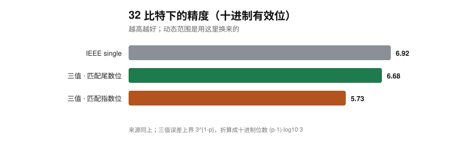

# trit-float：平衡三进制浮点（实验层）

`publish = false`。表示：`value = mantissa · 3^exponent`，尾数是平衡三进制整数，
规格化后最高位 `±1`，有效位数 ≤ `precision`。

这个 crate 现在能回答三个问题：**怎么舍入、一样比特下范围/精度怎么换、值不值得用**。
每个数字都能用 `trit-float stats|range|rounding` 重跑。

## 舍入

| 模式 | 平局处理 |
|---|---|
| `RoundMode::HalfAway`（默认） | 远离零，取更大量级 |
| `RoundMode::HalfEven` | 取偶尾数（对齐 IEEE 的 ties-to-even） |

实测（`trit-float rounding`，平局取样 = 相邻可表示值的中点）：

| 精度 p | HalfAway 平局偏差 | HalfEven 平局偏差 | 平局样本 |
|---:|---:|---:|---:|
| 4 | **+0.60%** | **−0.52%** | 720 |
| 8 | +0.006% | −0.002% | 59,040 |
| 12 | ≈0 | ≈0 | 4,782,960 |

结论要反着说：**"奇数基 + 对称舍入 ⇒ 期望误差为零"在本仓的取样口径下没有复现**。
HalfEven 不是把偏差压成 0，而是把它**翻了个符号、量级相近**；真正让它消失的是精度本身
（p=12 时两者都在浮点噪声内）。这条记为未验证，不当作卖点。

## 同比特：范围与精度的交换

`Format { precision, exponent_digits, taper }`。指数用 `E` 位平衡三进制，
指数本身的范围是 `3^±((3^E−1)/2)`——随 `E` **指数**增长，比二进制的 `2^±(2^E)` 快得多。
代价是尾数位被挤占。三种分配口径（32 比特预算下）：

| 格式 | log10 动态范围 | 十进制有效位 |
|---|---:|---:|
| IEEE single（23 尾数 + 8 指数） | 83.4 | 6.92 |
| 三值 · 匹配尾数位（p=15, E=4） | 45.0 | 6.68 |
| 三值 · 匹配指数位（p=13, E=6） | **353.2** | **5.73** |
| 三值 · 范围优先（p=9, E=10） | 28177 | 3.82 |




怎么读：

- **动态范围确实能换宽**：32 比特下匹配指数位，范围比 IEEE single 宽 **4.2 个数量级**；
  16 比特下匹配尾数位，范围比 half 宽 **3 个数量级**（10^15 vs 10^12）。
- **但从来不是白拿**：32 比特匹配指数位时，有效位从 6.92 掉到 5.73（误差约 **15×**）；
  再想宽就只能继续砍尾数（范围优先一档只剩 3.82 位）。
- **"同比特精度 3× 差"的旧结论不变**：那是按尾数位对齐的口径（`3^{1-p}` vs `2^{-B}`），
  与这里的范围/精度交换是两笔账，不能混谈。
- **锥形精度（`taper`）只是旋钮，不是 Takum**：它让精度随 `|指数|` 递减（单测覆盖），
  但真正的 Takum 需要**锥形指数编码**，本仓没做。范围表里没有放 taper 行，避免拿它冒充 Takum。

## 跑

```bash
cargo run -p trit-float -- stats      # 同尾数位：三值 vs 二进制的误差上界
cargo run -p trit-float -- range      # 同比特：范围/精度交换（16/32/64）
cargo run -p trit-float -- rounding   # 平局处理的方向偏差
cargo test -p trit-float              # 18 个单测（含 Format 溢出/下溢/锥形）
```

## 边界

- 指数范围按 `3^E` 增长，很多档位在物理上没有意义（例如 64 位"范围优先"到 10^10 量级的天文数字）；
  真实格式会给指数加约束，本表的极端行只用来展示交换曲线。
- 没有次正规数、NaN/Inf、舍入标志位；`Format::quantize` 溢出的处理是返回 `None`，
  下溢返回 0。
- 算术（`+`/`*`）仍用默认 `HalfAway`；舍入模式目前只影响**构造**，不影响运算结果。
