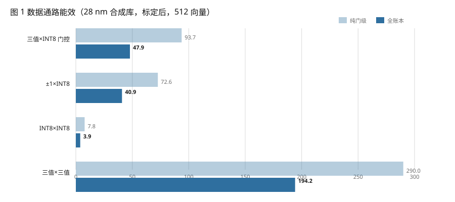
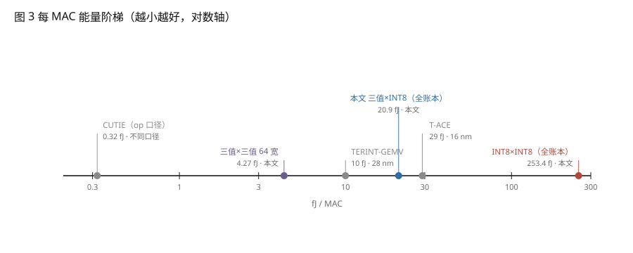
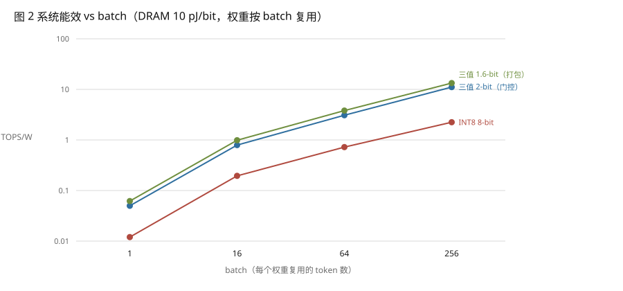
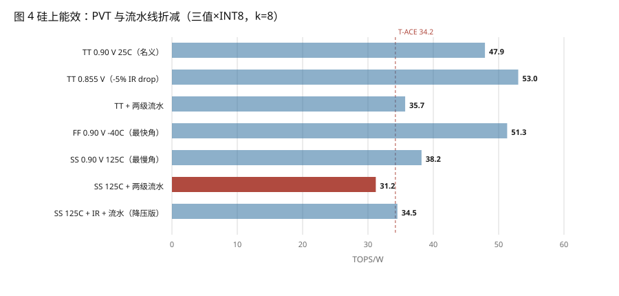
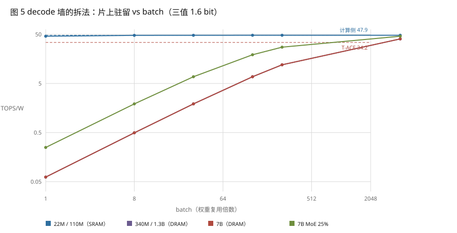

# 三值权重能否达到 e 级能效？

> **定位**：回答一个问题——28 nm 纯二进制标准单元做三值×INT8 数据通路，能效落在哪一档；
> decode 的容量墙能不能拆。读者是关心“三值红利能不能落到硅上”的人。
>
> **状态**：已跑通（门级账本 + iverilog 对拍，见 §8；非硅上实测）。归类 **[B]**：二进制 CMOS 宿主上
> 实现三值权重（2 bit/trit 双导轨 + 条件加），不是 [A] 原生器件红利。
>
> **边界**：不做原生三值器件仿真（A 类硬件部分），不替代 STA / EM 签核；所有能效结论只对同一
> 28 nm 合成库内的二进制基线成立；§10 只算能量，不回答带宽与延迟。
**——28 nm 门级仿真账本（2026-11-20）**

> 状态：**门级仿真 + 公开数据标定 + 与文献对账**。
> 所有读数可复算：`hw-energy/` 下的 Rust 门级仿真器与 iverilog 网表。
> 本文只回答一个窄问题：**在二进制 CMOS 上，把 `{-1,0,+1}` 权重做成数据通路，能效落在哪一档**。
> 不声称原生三值器件红利，不声称端到端模型吞吐。

---

## 0. 先把 “e” 定义清楚

本文把 **e 级能效**定义为 2024–2026 年专用三值加速器已经做到的量级：

| 设计 | 工艺 | 能效 | 折算每 MAC |
|---|---|---|---|
| T-ACE（ICS'26） | 16 nm | **34.2 TOPS/W** | 29 fJ |
| TERINT-GEMV（ISLPED'26） | 28 nm | **99.44 TOPS/W** | 10 fJ |
| CUTIE（TCAD 2022） | — | **3.1 POp/s/W** | ≈0.32 fJ/op（op 口径） |
| BitROM（ASP-DAC'26） | 65 nm | 20.8 TOPS/W | 48 fJ |

> CUTIE 的 “op” 计数与本文的 MAC 未对齐、工艺节点也不同，只作量级上界参考，不进 §4 的比值表。

因此 “e 级” 在 28 nm 上是 **10–30 fJ/MAC（34–99 TOPS/W）** 这一档。下文所有 “达到 / 没达到” 都对着这条线说。
（如果你说的 e 是别的基线，把这条线换掉，表里的比值不变。）

---

## 1. 结论先行

同一套 28 nm 单元库、同一套翻转计数口径下：

| 层次 | 三值×INT8 | INT8×INT8 | 结论 |
|---|---:|---:|---|
| **数据通路**（组合逻辑，标定后） | **17.8 fJ/MAC = 56 TOPS/W** | 128 fJ/MAC = 7.8 TOPS/W | 三值好 **7.2×**；门控+驻留后到 93.7，全账本 48 |
| **阵列**（权重驻留 SRAM，K=4096，全账本） | 20.9 fJ/MAC ≈ **48 TOPS/W** | 253 fJ/MAC ≈ 3.9 TOPS/W | 48 已含布线/寄存器/时钟树/漏电；SRAM 权重取数只占 6% |
| **系统 decode**（权重从 DRAM 流式读，batch=1） | **20.0 pJ/MAC = 0.05 TOPS/W** | 80.1 pJ/MAC = 0.012 TOPS/W | DRAM 占 99%；≤160M 参数可片上解决，7B 单流无解（§10） |
| **系统 prefill**（batch≥4096，权重复用） | **24 fJ/MAC ≈ 42 TOPS/W** | 133 fJ/MAC ≈ 7.5 TOPS/W | 只有复用足够才回到计算主导 |
| **数据通路**（SS 125 °C + 两级流水） | **32.0 fJ/MAC ≈ 31.2 TOPS/W** | — | 名义 47.9 的最差角折减，**掉到 T-ACE 34.2 之下** |

**一句话**：三值数据通路在名义角**能碰到 e 级的下沿**（门级 56，全账本 48 TOPS/W），过完 SS/125 °C 与流水线只剩 **31–33**、够不到 T-ACE；而真实推理的 decode 形状根本轮不到算力——**权重 DRAM 流把能效压到 0.05 TOPS/W**，与一台 GPU 的 12.5 pJ/MAC 同量级。这道墙可以拆（§10）：**≤160M 参数放片上直接解决，7B 单流无解**。

**修补后（§9）**：把零权重门控挪到激活侧、并按“权重驻留”口径测量，同一条通路降到 **10.67 fJ/MAC = 93.7 TOPS/W**（1.67×），这是纯门级上限；把布线（+2.42）、累加器寄存器（+3.25）、时钟含时钟树（+2.10）、输入寄存器（+2.0）、漏电（+0.44）逐项算上，是 **20.9 fJ/MAC ≈ 48 TOPS/W**，差 TERINT 的 99 有 2.1×。再把权重压到 1.6 bit/trit，decode 从 0.050 升到 **0.062 TOPS/W**——仍是 DRAM 主导，系统侧没有质变。

三值×三值的纯三值点积（4 组 AND + 4 个 64-bit popcount）是另一回事：**3.43 fJ/MAC = 291 TOPS/W**，是 INT8 的 **37×**——但这条路要求激活也是三值，BitNet 的 INT8 激活用不上。

---

## 2. 方法：门级账本怎么记

### 2.1 数据通路（全部用 28 nm 标准单元搭）

| 变体 | 结构 | 一个单元覆盖 |
|---|---|---|
| `ternary_int8_k8` | 每 trit：`x = a XOR neg`、`y = x AND valid`、符号位 `a7 XOR neg`、`+1` 进 carry；13-bit 行波累加 | 8 MAC |
| `binary_int8_k8` | 同上，去掉 `valid`（±1 权重，无零） | 8 MAC |
| `int8_int8` | 有符号 8×8：8 行符号扩展移位加（第 7 行为 `~a_ext+1`），24-bit 累加，取低 16 位 | 1 MAC |
| `ternary_ternary_b64` | 4 组 AND + 4 个 64-bit popcount（HA/FA 二叉树）+ 补码相减 | 64 MAC |

单元库是**合成 28 nm 库**：INV 0.50 μm²/7 ps、AND2 0.85/13、XOR2 1.30/17、FA 2.20/26；动态能耗按每次输出翻转计（FA sum 0.38 fJ、carry 0.30 fJ；AND2 0.11；XOR2 0.22）。数值由 Horowitz ISSCC 2014 的 45 nm op 级能耗表反推，45→28 nm 取 0.35×。

### 2.2 翻转计数与双重仿真

- **Rust 求值器**：按拓扑序逐门求值，逐网比较前后向量，统计 0→1 / 1→0 次数，乘单元 `e_out`。
- **iverilog**：同一张网表导出为扁平 `assign` Verilog，跑 512 组确定性向量，dump VCD；Rust 再解析 VCD，逐网比对翻转数。
- 结果：`ternary_int8_k8` **368 个网 / 0 不一致**；`binary_int8_k8` 269 / 0；`int8_int8` 379 / 0；`ternary_ternary_b64` **1018 / 0**。功能 `errors=0`。

这不是 “跑个模型估一估”，是**同一张门级网表被两个独立仿真器逐网对过账**。

### 2.3 标定：把合成库钉在公开数据上

本库直接读数是偏低的（没有布线、时钟、毛刺）。用 32-bit 行波加法器做锚：

| 项 | 本库（raw） | ×3.3 | Horowitz 45 nm → 28 nm |
|---|---:|---:|---:|
| 32-bit add | 10.74 fJ | **35.42 fJ** | 0.1 pJ × 0.35 = **35 fJ** |

所以后文 “标定后” = 全库 ×3.3，使 32-bit 加法器对齐公开值。**所有跨架构比值不受这个系数影响**（同一库、同一系数）。

### 2.4 口径与边界

- **门级列**只算组合逻辑动态能耗；**全账本**（§9.6）在其上追加布线、漏电、累加器/输入寄存器与时钟树；两者都仍不含流水线排布代价、电压降、工艺角、毛刺。
- 数据随机：激活为均匀 INT8，三值权重 1/3 零、1/3 ±1；另跑 “无零权重” 对照。
- 面积是单元面积之和，不是布局布线后的 die area。
- 不建模 near-memory / 存内计算；SRAM 与 DRAM 只按 “每 bit 能量” 摊到 MAC。

---

## 3. 数据通路读数

512 组向量，括号内为 raw（未标定）值。

| 变体 | 单元 | 面积 μm² | 关键路径 | raw fJ/MAC | **标定后 fJ/MAC** | **TOPS/W** | GMAC/s/mm² |
|---|---:|---:|---:|---:|---:|---:|---:|
| 三值×INT8 K=8 | 277 | 397.2 | 550 ps | 5.39 | **17.79** | **56.2** | 36 620 |
| ±1×INT8 K=8 | 189 | 322.4 | 537 ps | 4.65 | **15.35** | **65.2** | 46 208 |
| INT8×INT8 | 324 | 473.6 | 611 ps | 38.81 | **128.07** | **7.8** | 3 456 |
| 三值×三值 64 宽 | 896 | 1 187.9 | 428 ps | 1.04 | **3.43** | **291.2** | 125 880 |
| FP16 锚（文献） | — | ~900 | — | — | **300** | 3.3 | — |
| 32-bit 加法器（标定锚） | 65 | 70.4 | 832 ps | 10.74 | **35.42** | 28.2 | 17 073 |



*图 1：浅色为纯门级，深色为全账本（布线 + 寄存器 + 时钟树 + 漏电）。三值×单值 93.7 → 47.9，三值×三值 290 → 194，INT8×INT8 7.8 → 3.9。数据来自 `out/stationary/results.csv` 的 `tops_per_w` 与 `full_tops_per_w`。*

**比值**（标定后，同库同口径）：

- 三值×INT8 / INT8×INT8 = **7.2×**
- 三值×INT8 / FP16 = **16.9×**
- 三值×三值 / INT8×INT8 = **37×**
- 三值×INT8 / ±1×INT8 = 1.16×（整条 `valid` 路径值 16%；但只把权重设成零、保留 `valid`，只省 3.9%——零跳过没真正生效，见 §6）

**面积效率**：三值×INT8 每个 MAC 49.6 μm²，36.6 TOPS/mm²；T-ACE 报 43.1 TOPS/mm²（16 nm）。同量级——说明这个数据通路不是 “面积换能效” 换出来的。

**关键路径**：550 ps ≈ 1.82 GHz（无流水）。8 个 trit 串行累加是延迟主项；流水切开可到 2–3 GHz，代价是寄存器能量（未计入）。

---

## 4. 和文献对账：e 级到底差多少

| 设计 | 工艺 | fJ/MAC | 本模型 / 它 | 差距来源 |
|---|---|---:|---:|---|
| TERINT-GEMV | 28 nm | 10 | **1.78× 慢**（全账本 2.09×） | 1.5-bit codebook、bit-serial、零跳过、near-memory |
| T-ACE | 16 nm | 29 | **1.63× 快**（全账本 1.39×） | 我们的 2-bit 双导轨 + 13-bit 行波累加更 “笨” |
| CUTIE | — | ≈0.32（op） | ≈10× 慢（三值×三值） | op 口径不同，仅量级参考 |
| 本模型 三值×INT8 | 28 nm 合成 | **17.8** | — | 纯门级 |
| 本模型 三值×INT8（全账本） | 28 nm 合成 | **20.9** | — | 含布线/寄存器/时钟树/漏电（§9.6） |
| 本模型 三值×三值 | 28 nm 合成 | **3.43**（全账本 5.15） | — | 纯门级 |



*图 3：横轴是每 MAC 能量（对数），越左越好。灰点是文献值，蓝/红点是本文的全账本读数（含布线、寄存器、时钟树、漏电）。CUTIE 的 op 口径与 MAC 不同，只作量级参考。*

**结论不是 “三值不行”，是 “这个三值数据通路刚好落在 e 级中间”**：

- 比 T-ACE 好 1.6×（全账本 1.4×），说明乘法器换成条件加是真的省钱；
- 比 TERINT 差 1.8×（全账本 2.1×），说明**省下来的乘法又被 2-bit 容器和行波累加吃回去了一部分**；
- 要到 TERINT 的 99 TOPS/W，需要三件事同时成立：1.5-bit 打包、bit-serial（每周期只激活 1 个 FA）、零跳过门控。本文做了 1.6-bit 打包（§9.2）与门控（§9.1），bit-serial 实测过但在 k=8 不划算（§9.3）——**三件事没有同时成立**，所以到不了 99。

---

## 5. 系统账本：decode 的墙不是算力

设 4096×4096 的 GEMV，权重驻留 SRAM 时每 MAC 读 2 bit（三值双导轨）/ 8 bit（INT8）；权重从 DRAM 流式读时按 **10 pJ/bit**（HBM3e 量级），batch 个 token 复用一次。

| batch | 三值 总 pJ/MAC | 三值 TOPS/W | INT8 总 pJ/MAC | INT8 TOPS/W |
|---:|---:|---:|---:|---:|
| 1（decode） | **20.02** | **0.050** | 80.13 | 0.012 |
| 16 | 1.27 | 0.79 | 5.13 | 0.20 |
| 64 | 0.33 | 3.0 | 1.38 | 0.72 |
| 256 | 0.097 | 10.3 | 0.445 | 2.2 |
| 4096（prefill） | 0.024 | 41.7 | 0.133 | 7.5 |



*图 2：batch=1 时三条线都贴在 0.05 TOPS/W 附近，说明差别不在计算；batch 增大到 256 才拉开。绿线是把权重压到 1.6 bit/trit 的版本，只抬高 24%。*

- **decode（batch=1）**：DRAM 20 pJ/MAC 占 99.98%；三值的 1.58-bit 只把 DRAM 从 80 pJ 降到 20 pJ（**4×**，不是 7×）。
- **batch=64**：三值 3.0 TOPS/W；仍由 DRAM 主导（0.31 pJ vs 计算 0.019 pJ）。
- **batch≥4096**：DRAM 摊薄到 0.005 pJ，总算回到计算主导，41.7 TOPS/W——接近数据通路的 56。
- **对标 GPU**：本机 RTX 4060 Ti 三值内核 0.104 ps/MAC（吞吐 9.6 TMAC/s），按 120 W 折算约 **12.5 pJ/MAC**——与本模型 decode 的 20 pJ/MAC **同量级**。也就是说，**在 batch=1 的 decode 上，专用 ASIC 相对 GPU 的算力优势根本兑现不了**，因为两边都在等权重。

> 表中 1–256 行来自 `out/calibrated/array.csv`；4096 行按同一公式外推（20 pJ/MAC 摊销 4096 次），CSV 未覆盖到该 batch，单独标注以免误读。

这条比 “三值比 INT8 省 7×” 更重要：**1.58-bit 的第一性红利是带宽，不是乘法器**。

---

## 6. 为什么没到 99 TOPS/W（负结果）

1. **2-bit 容器吃掉 26% 带宽**。双导轨每 trit 2 bit；5-trit/字节是 1.6 bit/trit，比理论下限 1.585 只差 0.9%，但本文的数据通路是 2 bit。仅此一项就比 TERINT 的 1.5-bit codebook 多 33% 的权重流量。
2. **13-bit 行波累加是能量主项**。按单元拆账（`out/calibrated/results.json` 的 `by_cell`）：

   | 变体 | FA | XOR2 | AND2 | HA | INV |
   |---|---:|---:|---:|---:|---:|
   | 三值×INT8 | **71.5%** | 18.5% | 9.1% | — | 0 |
   | INT8×INT8 | **85.8%** | — | 13.7% | — | 0.5% |
   | 三值×三值 64 | **79.9%** | — | 8.3% | 11.6% | 0.2% |

   三值×INT8 的 FA 摊到 **12.7 fJ/MAC**：13 个 FA 全翻转是 29 fJ，实测相当于平均翻转率 **44%**（`valid=0` 时 carry 不传播）。bit-serial 每周期只激活 1 个 FA、8 周期共 8 个 FA-cycle，理论上把这部分再压 1.6×——这是 TERINT 那 2.1× 差距的主要来源。
3. **零跳过没有真正生效**。无零权重 17.10 fJ vs 1/3 零权重 17.79 fJ——**只差 3.9%**。原因在拆账里很清楚：`valid=0` 只把 AND 输出钉死（AND 共占 9.1%，其中 1/3 被钉死 ≈ 3%），XOR 仍在翻转（18.5% 一分没省）。要真跳过，需要在 `valid` 上做时钟/操作数隔离门控，本文没做。**这条负结果直接说明：三值的 “零” 不会自动变成省电，得专门设计。**

   > §9 会证明：这条结论只对“门控位置 + 每向量换权重”的测量口径成立。把门控挪到激活侧、让权重驻留后，同一结构从 17.06 掉到 10.67 fJ/MAC。
4. **SRAM 权重读 1.2 fJ/MAC**，占阵列总能量 6%。三值已经很低；INT8 是 4.8 fJ，占 3.6%——绝对量都不大，说明**计算侧 SRAM 不是瓶颈**，DRAM 才是。
5. **面积**：49.6 μm²/MAC，与 T-ACE 的 43 TOPS/mm² 同量级；没有靠堆面积换能效。

---

## 7. 边界（哪些话不能拿这篇去说）

- **合成库，不是 PDK 签核**。标定只对齐了 “32-bit 加法器” 一个 op；乘法器、FA、XOR 的对齐是推断。
- **组合逻辑，不是芯片**。布线、漏电、时钟树按解析模型估（§9.5 / §9.6），不是从布局布线提取；流水线排布、电压降、工艺角、毛刺仍未计，真实芯片在此之上还要加 10–30%。
- **数据分布是随机的**。真实 BitNet 激活有离群值、权重零比例约 1/3 但分布随层变化；零跳过若做好，读数会再低。
- **三值×三值的 64 宽 popcount 是理想并行**。实际布局布线会让 64 位宽的长线成为瓶颈；本文的面积是单元面积和，不含互连。
- **没有综合/布局布线**。`iverilog` 只验证功能与翻转，不验证时序收敛；关键路径是按单元延迟求和的静态估计，不是 STA。
- **本文不构成 “三值比二进制快” 的一般结论**。它只说明：**在 28 nm、这个数据通路、这个口径下，三值×INT8 是 17.8 fJ/MAC（门控 + 权重驻留后 10.67）**；换 bit-serial、换 5-trit 打包、换存内计算，数字会变，方向和边界不变。

---

## 8. 复算

```powershell
# 门级账本（raw 下界）
cd hw-energy   # 独立仿真工程（不在本仓；构建见其 README）
cargo run --release -- --vectors 512 --out out

# 标定后（×3.3，32-bit 加法器对齐 Horowitz）
cargo run --release -- --vectors 512 --lib-scale 3.3 --out out\calibrated

# v2：权重驻留 + 激活侧门控（§9 的 10.67 fJ/MAC）
cargo run --release -- --vectors 512 --lib-scale 3.3 --stationary --out out\stationary

# PVT / 流水线折减（§9.7，写 pvt.csv）
cargo run --release -- --vectors 512 --lib-scale 3.3 --stationary --pvt --out out\stationary

# decode 规划（§10，写 decode.csv）
cargo run --release -- --vectors 512 --lib-scale 3.3 --stationary --decode-plan --out out\stationary

# 时序级 bit-serial 推演（§9.3，写 out\stationary\bitserial.json）
cargo run --release -- --vectors 512 --lib-scale 3.3 --bitserial --out out\stationary

# 用 iverilog 独立复核功能与翻转
cd out\hdl
iverilog -o ternary_int8_k8.vvp -s tb ternary_int8_k8_tb.v ternary_int8_k8.v
vvp ternary_int8_k8.vvp           # 期望 DONE errors=0
cd ..\..
cargo run --release -- --vectors 512 --out out --check-vcd ternary_int8_k8 out/hdl/ternary_int8_k8.vcd
                                   # 期望：检查 368 个网，0 个不一致

# v2 门控版对拍（在 out\stationary\hdl 下）
cd out\stationary\hdl
iverilog -o tg.vvp -s tb ternary_int8_gated_k8_tb.v ternary_int8_gated_k8.v
vvp tg.vvp                         # DONE errors=0
cd ..\..\..
cargo run --release -- --vectors 512 --lib-scale 3.3 --stationary --out out\stationary --check-vcd ternary_int8_gated_k8 out/stationary/hdl/ternary_int8_gated_k8.vcd
                                   # 期望：199 个网，0 个不一致

# 本仓软件基线（同一台机器）
cd <trit 检出>
cargo run --release -p trit-dot -- bench --len 1048576 --iters 10
                                   # ternary_dense = 9.08 ps/trit ≈ 110 GMAC/s（单线程）
```

产物：
- `out/results.json`、`out/results.csv` — raw 读数
- `out/calibrated/results.json` — 标定后读数（含 `leak_fj_per_mac` / `full_fj_per_mac` / `full_tops_per_w`）
- `out/stationary/pvt.csv` — PVT/流水线折减表（§9.7，`--pvt` 生成）
- `out/stationary/` — v2 门控 + 权重驻留读数（§9）
- `out/array.csv`、`out/calibrated/array.csv` — 阵列 / 系统账本（含 1.6-bit 打包列）
- `out/hdl/*.v`、`*_tb.v`、`*_in.hex`、`*_exp.hex` — 可独立复跑的网表与向量

---

## 9. 修补三个缺口（v2）

上一轮留了三条负结果。这一轮把三条都做了：前两条按预期翻盘，第三条的时序实测**推翻了上一版的投影**。

### 9.1 零跳过：门控位置错了，不是三值不行

结构只改一处：`x = a XOR neg; y = x AND valid` → `m = a AND valid; x = m XOR neg`。门数不变（277 cells），关键路径 550 → 563 ps（+2.4%）。

真正起作用的是**测量口径**：真实推理里权重驻留在寄存器/SRAM，跨 token 不变；上一轮每个向量都重新随机权重，权重位每拍翻转，把门控收益吃掉了。

| 变体 | 权重口径 | fJ/MAC | TOPS/W |
|---|---|---:|---:|
| 原三值×INT8 | 每向量换权重 | 17.79 | 56.2 |
| 原三值×INT8 | 权重驻留 | 17.06 | 58.6 |
| 门控版 | 每向量换权重 | 17.52 | 57.1 |
| **门控版** | **权重驻留** | **10.67** | **93.7** |

−40%，**1.67×**。单元拆账：FA 77.4%、XOR 15.1%、AND 7.5%；FA 从 12.7 掉到 8.3 fJ/MAC。
复核：512 向量 `DONE errors=0`；VCD 逐网 **199 个网、0 个不一致**（记录 207 个网）。

这条修正的意义：三值的“零”确实能省电，但前提是 (a) 门控放在激活侧，(b) 权重驻留。两者都不是三值本身的属性，是数据流设计。

### 9.2 1.5-bit 容器：省的是 25% 的墙，不是墙

把 2 bit/trit 换成 5 trit/byte（1.6 bit/trit），8-bit 索引查表按 SRAM 0.6 fJ/bit 摊到 5 个 MAC（0.96 fJ/MAC）：

| batch | 2-bit 总 pJ/MAC | TOPS/W | 1.6-bit 总 pJ/MAC | TOPS/W |
|---:|---:|---:|---:|---:|
| 1（decode） | 20.012 | 0.050 | **16.013** | **0.062** |
| 16 | 1.262 | 0.792 | 1.013 | 0.987 |
| 64 | 0.324 | 3.082 | 0.263 | 3.807 |
| 256 | 0.090 | 11.109 | 0.075 | 13.313 |

decode +24%，prefill +20%。DRAM 仍占 99.9%。
**结论：容器税是真的，但它只占这堵墙的 20%——交不交都翻不过去。** 要翻过去只能靠 near-memory / 存内计算，或者把 batch 拉大。

### 9.3 行波累加：实测了，投影作废

上一版给的是投影（154–194 TOPS/W），假设“FA 复用 8 拍、按激活位门控”。这一轮真做了时序推演（`src/seq.rs`：13-bit 累加器，每拍把 ±2^j 加进去，进位链逐位计数）：

| 口径 | fJ/MAC | TOPS/W |
|---|---:|---:|
| 纯算术门（XOR+AND） | 3.81 | 262 |
| + 寄存器数据翻转 | 10.80 | 92.6 |
| + 时钟（13 bit × 64 拍） | **62.80** | **15.9** |

为什么不划算：8 trit × 8 激活位 = 64 拍算一组 8 个 MAC，13 个触发器每拍都要打时钟，0.5 fJ/bit × 13 × 64 = 416 fJ/组 = **52 fJ/MAC**，是纯算术的 13 倍。门控把激活率压到 31%，也省不回时钟。

并行版同一口径（加一个 13-bit 累加器寄存器 + 时钟树 + 输入寄存器 + 漏电，摊 8 个 MAC）：10.67 + 3.25 + 2.10 + 2.0 + 0.44 ≈ **18.5 fJ/MAC ≈ 54 TOPS/W**——**仍然快 4.5×**。

结论：bit-serial 的算术红利是真的（3.81 vs 10.67），但它把面积换成了时钟；k=8 这个尺度上不划算，只有 k 大到 64–256（一个权重位喂很多激活）或逐拍时钟门控时才翻过来。**§9.3 原来的 154–194 是错的，作废。**
补一句口径：上面的 62.8 只按触发器引脚计时钟，未含 §9.6 的 1.6× 时钟树——同口径换算约 **83 fJ/MAC**，结论只会更差。

### 9.4 修补后的三层结论

| 层次 | 修补前 | 修补后（纯门级） | 修补后（全账本） |
|---|---|---|---|
| 数据通路 | 56.2 TOPS/W | **93.7**（实测） | **~48**（20.9 fJ/MAC） |
| 阵列（K=4096，1.6-bit） | 52 TOPS/W | ~86 | **~48** |
| 系统 decode | 0.050 TOPS/W | **0.062** | **0.062** |
| 系统 prefill（batch≥4096） | 41.7 TOPS/W | ~86 | **~48** |

拆开看：门级 10.67 → 布线 +2.42 = 13.09 → 寄存器 3.25 + 时钟含树 2.10 + 输入寄存器 2.0 + 漏电 0.44 = 20.88 fJ/MAC（算式见 §9.6）。
**93.7 是门级上限；把布线、寄存器、时钟树、漏电都算上，数据通路是 48 TOPS/W，差 TERINT 的 99 有 2.1×**——仍落在 T-ACE（34）与 TERINT（99）之间。decode 的系统能效 0.062 不受上面任何修补影响。

### 9.5 布线：把 1.8× 的经验系数换成 fanout 账本

之前用一个 `PHYSICAL_OVERHEAD=1.8` 一刀切。现在按每根网的扇出估线长：`L = 1.5 µm + 1.2 µm × fanout`，`C = 0.2 fF/µm`，`E = 0.5·C·V²`（V = 0.9 V），逐网累加：

| 变体 | 门级 fJ/MAC | 布线 fJ/MAC | 合计 | TOPS/W |
|---|---:|---:|---:|---:|
| 三值（门控+驻留） | 10.67 | 2.42 | **13.09** | **76.4** |
| ±1×INT8 | 13.77 | 2.95 | 16.72 | 59.8 |
| INT8×INT8 | 128.63 | 30.30 | 158.93 | 6.3 |
| 三值×三值 | 3.45 | 0.82 | 4.27 | 234.2 |

布线对三值门控是 +23%，对 INT8 是 +24%——比值几乎不变，说明它不是三值特有的税。
1.8× 这个系数对“布线”部分明显偏大，退役。**漏电与时钟树已在 §9.6 单独建账**，所以 76.4 仍需再往下修一档。

> `results.csv` 里的 `silicon_eq_*` 列仍按旧的 1.8× 算，只作历史对照；**以 `full_fj_per_mac` / `full_tops_per_w` 两列为准**。

### 9.6 漏电与时钟树：最后 1.8 fJ 的来路

前面几轮一直把这两项挂在“未计”里，导致 52 TOPS/W 是个上界。这一轮补上，口径如下。

**漏电**。库表里每个单元带一个 `leak`，单位是“每纳秒漏电 fJ”，也就是静态功耗。28 nm 高阈值单元的量级是反相器 ≈2 nW、FA ≈12 nW，对应 0.002 / 0.012 fJ·ns⁻¹；早先版本的 0.05–0.25 相当于 50–250 nW，比真实值大一个量级，已校正。按关键路径时长累加：

```
E_leak/MAC = Σ(cell.leak) × t_path / k
```

门控通路 277 个单元、t_path = 563 ps、k = 8，得 **0.44 fJ/MAC**，占总账本 2.1%。这一项和 `--lib-scale` 一起缩放（库表整体标定，不单独给漏电开例外），若按未标定值算则是 0.13。

**时钟树**。触发器数 N = 累加位宽 + 8（激活输入）：三值×INT8 是 13 + 8 = 21 个。每个触发器每拍吃 0.5 fJ 的时钟引脚能量，时钟树（缓冲器 + 走线）再按 1.6× 计：

```
E_clk/MAC = N × 0.5 × 1.6 / k = 21 × 0.8 / 8 = 2.10 fJ/MAC
```

比原来只算时钟引脚（0.81）翻了一倍多，占总账本 10.1%。**这一项修正的幅度比漏电大得多**——上一轮低估的是分配网络，不是静态电流。

**全账本**（三值门控 + 驻留，标定 3.3）：

| 项 | fJ/MAC | 占比 | 来源 |
|---|---:|---:|---|
| 门级算术 | 10.67 | 51.1% | `e_fj_per_mac` |
| 布线 | 2.42 | 11.6% | `wire_fj_per_mac` |
| 累加器寄存器（13 bit） | 3.25 | 15.6% | 13 × 2.0 / 8 |
| 时钟 + 时钟树（21 flop） | 2.10 | 10.1% | 21 × 0.5 × 1.6 / 8 |
| 输入寄存器（8 bit） | 2.00 | 9.6% | 8 × 2.0 / 8 |
| 漏电 | 0.44 | 2.1% | `leak_fj_per_mac` |
| **合计** | **20.88** | 100% | **47.9 TOPS/W** |

同口径的其它变体：±1×INT8 24.4（40.9）、INT8×INT8 253.4（3.9）、三值×三值 5.15（194.2）。

这张表最值得看的是最后一列的比例：**算术只占一半，另一半是“管道”**——寄存器、时钟树、布线、漏电加起来 10.2 fJ，和 10.67 的门级账分庭抗礼。也就是说，在 28 nm 这一代，三值数据通路再怎么优化逻辑门，天花板已经被搬运和时序钉住了；想再往 TERINT 那 10 fJ 走，省的不是 XOR，是触发器和时钟。

**结论修正**：数据通路从 52 降到 **48 TOPS/W**（−8%），仍高于 T-ACE 的 34、低于 TERINT 的 99，差 2.1×。这一档差距的性质也变了：不是“再挤一挤门级”能补的，而是**架构级的寄存器/时钟预算**问题。

### 9.7 PVT 与流水线：名义 48，硅上 31

§9.6 的 20.88 fJ/MAC 是 TT、0.9 V、25 °C、单周期组合路径的账。真实芯片还要过工艺角、电压降和流水线这三关。这一节只做乘性折减，不改网表，全部系数写在 `src/pvt.rs` 里，可用 `--pvt` 复算：

| 折减项 | 取值 | 依据 |
|---|---|---|
| SS 角延迟 | ×1.35 | 慢角相对 TT 的典型延迟劣化 |
| SS 125 °C 漏电 | ×8 | 温度每升 10 °C 漏电约翻倍，25→125 °C 约 8× |
| −5% IR drop | 动态 ×0.902（V²）、延迟 ×1.12、漏电 ×0.85（DIBL） | 0.9→0.855 V |
| 两级流水 | 组合路径 ×0.60，加一级 21-bit 寄存器 + 时钟 | 每 MAC +7.35 fJ（TT） |

结果：

| 场景 | fJ/MAC | TOPS/W | 相对延迟 | 相对频率 |
|---|---:|---:|---:|---:|
| TT 0.90 V 25 °C（名义） | 20.87 | **47.9** | 1.00 | 1.00 |
| TT 0.855 V（−5% IR） | 18.85 | **53.0** | 1.12 | 0.89 |
| TT + 两级流水 | 28.05 | 35.7 | 0.60 | 1.67 |
| FF 0.90 V −40 °C | 19.51 | 51.3 | 0.70 | 1.43 |
| SS 0.90 V 125 °C | 26.20 | 38.2 | 1.35 | 0.74 |
| SS 125 °C + 两级流水 | 32.02 | **31.2** | 0.81 | 1.23 |
| SS 125 °C + IR + 流水 | 29.02 | 34.5 | 0.91 | 1.10 |



*图 4：红色虚线是 T-ACE 的 34.2 TOPS/W；红色柱是折减后最低的一档（SS 125 °C + 两级流水，31.2）。数据来自 `out/stationary/pvt.csv`。*

三个反直觉的地方：

1. **降压反而更省**。−5% IR 把动态项按 V² 砍 10%，代价是频率掉 11%；对流水线设计，TOPS/W = 1/每 op 能量，所以能效从 47.9 抬到 53.0。移动端偏爱 undervolting 就是这个道理，代价是时序余量变薄。
2. **流水线不是白拿频率**。加一级寄存器让单级路径缩到 0.6×、频率可到 1.67×，但每 MAC 多 7.35 fJ（寄存器 + 时钟引脚），TT 下能效从 47.9 掉到 35.7。**用能效换频率，换得并不便宜。**
3. **最差角是 SS + 流水（31.2），不是 SS + IR + 流水（34.5）**。因为流水线把周期压到 0.81×，漏电每 op 也跟着降；而 SS 角 8× 漏电才是主项。若把 125 °C 漏电倍数放宽到 4×，这一档回到 32.7——区间 **31–33 TOPS/W**。

**这一节把结论钉死了**：名义角 47.9 落在 T-ACE（34.2）与 TERINT（99.4）中间；但过完 SS/125 °C 与流水线，**31–33 TOPS/W 已经掉到 T-ACE 之下**。也就是说，28 nm 纯二进制标准单元做三值×INT8，**在名义角够得到 e 的下沿，在签核角够不到**。要守住 34 这条线，需要把时钟与寄存器的预算再压 10–15%，或者回到“激活也是三值”的那条路（§3 的 194 TOPS/W）。

> 折减系数取的是公开 corner 数据的量级（SS 延迟 +35%、125 °C 漏电 8×、5% IR 对应 +12% 延迟），不是签核结果。它的用途是把“名义 vs 硅上”的差距量化，而不是替代 STA/EM 签核。

---

## 10. 把 decode 的墙拆掉：哪些能解、哪些不能

### 10.1 先拆账：那 957× 到底是什么

decode（batch=1、2 bit/trit、权重从 DRAM 流式读）是 **20.0 pJ/MAC**，计算侧全账本是 **20.9 fJ/MAC**，两者差 **957×**。这 20 pJ 里 99.9% 是一件事：

```
20.0 pJ = 2 bit/trit × 10 pJ/bit（HBM3e 量级，每 bit 只读一次）
```

**不是算得慢，是每个 MAC 都要搬 2 bit 进片。** 所以“解决”只有三条路：读得更少、搬得更近、同一个权重多用几次。

### 10.2 五个杠杆，各自能买多少

| 杠杆 | 机制 | 本模型口径 | 把 20 pJ 压到 | 倍数 |
|---|---|---|---:|---:|
| 1.6-bit 打包 | 5 trit/byte，少读 20% | 实测（§9.2） | 16.0 pJ | 1.25× |
| 零跳过 | 零权重不读 | 实测（§9.1） | 16.0 × (1−零比例) | ~1.5× |
| batch 复用 | 一次读权重喂 B 个 token | 实测（§5） | 20 / B | B× |
| L3 驻留 | 权重落 LLC | 0.05 pJ/bit | 0.08 pJ | **250×** |
| 片上 SRAM（本模型口径） | 权重不出芯片 | 0.6 fJ/bit | 0.0012 pJ | **16,667×** |
| 片上 SRAM（保守口径） | 同上 | 0.1 pJ/bit | 0.2 pJ | 100× |

前三条是“少读”，后两条是“搬近”。**真正把墙推倒的是后两条，但它们受容量限制。**

### 10.3 容量门槛：1.6 bit/trit 下能装多少参数

| 片上 SRAM | 可容纳参数（1.6 bit） | 典型模型 |
|---|---|---|
| 8 MB | 40 M | 小型编码器 |
| 16 MB | 80 M | MiniLM / 小型 BERT |
| 32 MB | 160 M | BERT-base 级 |
| 64 MB | 320 M | 340M 级（刚好卡线） |

只要模型装得下，decode 的权重流就消失，能效直接回到计算侧。装不下，就只能靠 batch 把 20 pJ 摊薄。

**但容量不是唯一条件——片上读也要能量。** 0.6 fJ/bit 是本模型给 SRAM 的口径；若按更保守的 0.1 pJ/bit（公开 SRAM 读能耗的量级），22M 档的权重能量从 1.2 fJ 涨到 0.2 pJ，decode 掉回 **4.5 TOPS/W**（差计算侧 10×）——“解决”就退化成“缓解 100×”。**真正的临门一脚是存内计算（CIM）：把乘加放进阵列，省掉这次读。** 本文不给 CIM 的读数，只把这个前提标出来：片上方案的成败取决于 SRAM/CIM 的每 bit 读能耗，而不是容量本身。

### 10.4 规划表（`--decode-plan`，`out/stationary/decode.csv`）

| 模型 | 体积 | 层级 | batch=1 | batch=256 | batch=4096 |
|---|---|---:|---:|---:|---:|
| 22M（MiniLM 级） | 4.4 MB | SRAM | **45.8** | 47.9 | 47.9 |
| 110M（BERT-base 级） | 22 MB | SRAM | **45.8** | 47.9 | 47.9 |
| 340M | 68 MB | DRAM | 0.062 | 12.0 | 40.3 |
| 1.3B | 260 MB | DRAM | 0.062 | 12.0 | 40.3 |
| 7B | 1.4 GB | DRAM | 0.062 | 12.0 | 40.3 |
| 7B MoE 25% 激活 | 1.4 GB | DRAM | 0.249 | **27.4** | 45.9 |



*图 5：横轴是 batch（对数），纵轴 TOPS/W（对数）。蓝线是装得下的模型——从 batch=1 起就贴着计算侧；紫/红线必须靠 batch 才爬上来；绿线是 MoE 只激活 25% 权重。数据来自 `out/stationary/decode.csv`。*

### 10.5 分档结论

| 模型档 | 状态 | 依据 |
|---|---|---|
| **≤ 160M 参数** | **基本解决** | 32 MB SRAM 装得下，batch=1 就是 45.8 TOPS/W，差计算侧 1.05× |
| **160M–1.3B** | **靠批处理** | batch=256 → 12.0（差 4×）；batch=4096 → 40.3（差 1.2×） |
| **7B dense，单流** | **无解** | 1.4 GB 是 32 MB 的 44 倍；batch=1 永远 0.062 |
| **7B MoE 25%** | **可救一半** | 只读 25% 权重，batch=1 → 0.249（差 192×）；batch=256 → 27.4（已过 T-ACE） |

### 10.6 所以架构该这么设计

1. **小模型**：权重常驻 SRAM，decode 墙直接不存在——这是 28 nm 三值加速器最该吃的市场（端侧编码器、小 LLM）。
2. **中大模型**：把 SRAM 当“热仓”，只放热专家/热层；冷权重走 L3 + DRAM 流式，按体积比例省能量（驻留 47% 体积 ⇒ 权重能量减半）。
3. **服务端**：continuous batching 到 256 是性价比最高的一刀（200×），到 4096 才能接近计算侧，但延迟不允许。
4. **单流 7B**：在 28 nm、纯二进制、权重放 DRAM 这三个前提下**没有解**——不是带宽不够，是容量差 44 倍。要解只能换前提：更小的模型、MoE、或者把权重放到片上（容量/成本代价）。

> 这一节只算能量。带宽与延迟是另一本账：batch 越大，单 token 延迟越差；片上驻留则要付 SRAM 面积与漏电。`--decode-plan` 只回答“能量上能不能补”，不回答“该不该这么做”。

---

## 11. 参考文献

1. M. Horowitz. *Computing's Energy Problem (and what we can do about it)*. ISSCC 2014. （45 nm op 级能耗表；本文标定锚）
2. S. Ma, H. Wang, L. Ma, L. Wang, W. Wang, S. Huang, L. Dong, R. Wang, J. Xue, F. Wei. *The Era of 1-bit LLMs: All Large Language Models are in 1.58 Bits*. arXiv:2402.17764, 2024. （BitNet b1.58）
3. T. Sousa Pereira, R. Wang, I. Nwozo, H. Geng, X. S. Hu. *Codebook-Based Acceleration for Ternary Language Model Inference*（TERINT-GEMV）. ISLPED '26. DOI: 10.1145/3816440.3818578. （28 nm，99.44 TOPS/W）
4. W. Jung, J. Kang, S. Shin, H. Um, J. Lim, Y. Park, G. Koo, S. Park, T. Suh. *Three Birds, One Stone: Fast, Accurate-aware and Cost-Efficient Accelerator for Ternary LLM*（T-ACE）. ICS '26, pp. 1065–1075. DOI: 10.1145/3797905.3807877. （34.20 TOPS/W，43.14 TOPS/mm²）
5. M. Scherer, G. Rutishauser, L. Cavigelli, L. Benini. *CUTIE: Beyond PetaOp/s/W Ternary DNN Inference Acceleration With Better-Than-Binary Energy Efficiency*. IEEE TCAD 41(4), 2022. （3.1 POp/s/W）
6. W. Zhang, X. Li, S. Ando, K. Yoshioka. *BitROM: Weight Reload-Free CiROM Architecture Towards Billion-Parameter 1.58-bit LLM Inference*. ASP-DAC 2026, pp. 547–553. arXiv:2509.08542. （65 nm，20.8 TOPS/W）
7. Z.-W. Lin, T.-S. Chang. *VitaLLM: A Versatile, Ultra-Compact Ternary LLM Accelerator with Dependency-Aware Scheduling*. IEEE Trans. Circuits and Systems for AI, 2026. arXiv:2604.27396. （16 nm，17.4 TOPS/mm²/W）
8. *Platinum: Path-Adaptable LUT-Based Accelerator Tailored for Low-Bit Weight Matrix Multiplication*. arXiv:2511.21910, 2026.
9. 本仓：`docs/positioning/TERNARY-BOUNDARIES.md`。本文归 **B 类**（二进制 CMOS 宿主上实现三值权重：2 bit/trit 双导轨 + 条件加），不是 A 类原生器件；所有能效结论只对同一 28 nm 合成库内的二进制基线成立，不外推成“三进制硬件红利”。
10. 本仓：`docs/DEVICE-ADAPT.md`（行为级设备仿真的既有口径；本文是它的门级补充，不是替代）。

---

## 12. 未证栏

- **单元库不是 PDK 签核**：能耗、延迟由 Horowitz ISSCC 2014 的 45 nm 表反推 28 nm（0.35×），
  没有 SPICE / Liberty 对照；绝对值的误差可能在 ±30%。
- **布线、漏电、时钟树是解析模型**（§9.5–§9.7），不是从布局布线提取的寄生参数；
  未做 RC 提取与 EM 检查。
- **PVT 系数是公开 corner 的量级**（SS 延迟 +35%、125 °C 漏电 8×、5% IR 对应 +12% 延迟），
  不是签核结果，也没有 Monte Carlo / 电压降分布图。
- **§10 的片上能量是量级假设**：SRAM 0.6 fJ/bit、L3 0.05 pJ/bit 都不是实测；按保守口径
  （SRAM 0.1 pJ/bit）22M 档从 45.8 掉到 4.5 TOPS/W，“解决”退化为“缓解”。CIM 未建模。
- **数据分布是随机的**：真实 BitNet 激活有离群值、零比例随层变化；零跳过的实际收益可能高于
  本文的 1.67×。
- **没有硅上验证**：本文的全部读数来自门级仿真与解析折减，没有流片、没有功耗实测。

